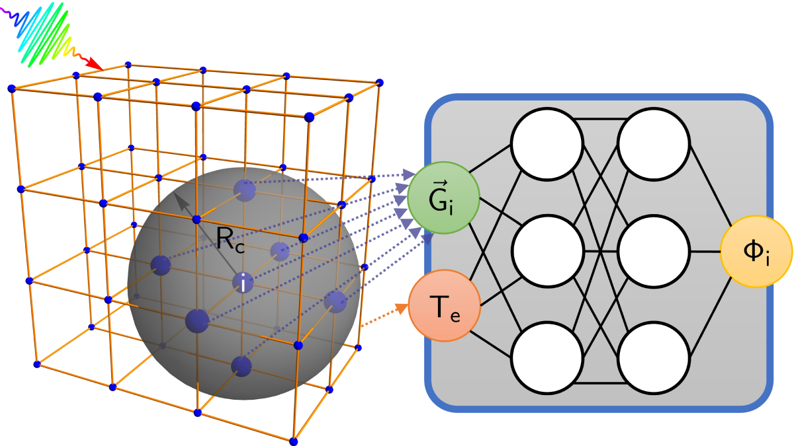

-------
TeNNPot
-------

TeNNPot is the official PyTorch implementation of the
electronic-temperature-dependent neural-network potential for laser-excited
silicon published in Communications Materials 4, 63 (2023). It includes the
trained silicon model and tools for training new single-element models.

Installation
============

Python 3.10 or newer is required. Install from the repository::

    git clone https://github.com/pasplett/TeNNPot.git
    cd TeNNPot
    python -m pip install .

Shell commands below are written on single lines so they can be copied into
PowerShell as well as POSIX shells.

Use the published model
=======================

The trained model is included; no separate download is required. Use it
through ASE to calculate free energies and forces::

    from ase.build import bulk
    from tennpot import TeNNPotCalculator

    atoms = bulk("Si", "diamond", a=5.43)
    atoms.calc = TeNNPotCalculator(
        electronic_temperature=12631.0,  # K
        energy_reference="total",
    )
    print(atoms.get_potential_energy())  # eV
    print(atoms.get_forces())            # eV/angstrom

The published model supports elemental silicon only. Its training-temperature
range is approximately 316--31,578 K. Predictions outside that range or far
outside the structural training domain are extrapolations. See
`MODEL_CARD.md <MODEL_CARD.md>`_ for scientific scope and limitations.

``energy_reference="cohesive"`` returns the raw network free energy;
``"total"`` adds the isolated-atom free-energy reference.

To evaluate your own ASE-readable collection of structures::

    tennpot-predict input.extxyz predictions.extxyz --temperature 12631

Train a new model
=================

Provide an ASE Extended XYZ file. Each frame must contain:

- one chemical element;
- positions in angstrom, cell, and periodic boundary conditions;
- ``energy`` in eV;
- ``forces`` in eV/angstrom;
- ``electronic_temperature`` in K.

Select the input energy convention with ``--energy-reference cohesive``
(the default) or ``--energy-reference total``. For elements other than
silicon, supply cohesive targets and use ``energy_reference="cohesive"``
for inference; the isolated-atom reference is specific to silicon.

Start training with::

    tennpot-train dataset.extxyz --output runs/my-model

The defaults use float32, 50 epochs, batches of 20, and Adam at 0.001.
Run ``tennpot-train --help`` for available settings.

Training and prediction commands report invalid input and file errors with a
short message and a nonzero exit status. Add ``--debug`` to either command to
show the full traceback when diagnosing an error.

Try the included example::

    tennpot-train examples/silicon_demo.extxyz --model-config silicon_tiny --epochs 2 --batch-size 1 --device cpu --output runs/demo

These five synthetic silicon structures have targets generated by the bundled
model. They demonstrate the workflow and cannot produce a useful scientific fit.

Training another element
------------------------

The bundled model configurations specify silicon; training does not infer the
model's element from your dataset. For another element, create a custom JSON
configuration and pass it with ``--model-config``. For example, save this as
``make_ge_config.py`` to create a small germanium model configuration::

    import json
    from dataclasses import replace
    from pathlib import Path

    from tennpot.config import load_model_config

    config = replace(
        load_model_config("silicon_tiny"),
        name="germanium_tiny",
        element="Ge",
        training_temperature_range_mha=None,
    )
    Path("ge_tiny.json").write_text(
        json.dumps(config.to_dict(), indent=2) + "\n", encoding="utf-8"
    )

Generate the configuration, then train on your own germanium data using the
frame fields and units listed above. All frames must contain only germanium,
and their energy targets must use the cohesive convention::

    python make_ge_config.py
    tennpot-train ge_dataset.extxyz --model-config ge_tiny.json --energy-reference cohesive --epochs 2 --batch-size 1 --device cpu --output runs/ge-demo

Use the resulting checkpoint to predict energies and forces for germanium
structures at an electronic temperature of 5000 K::

    tennpot-predict ge_input.extxyz ge_predictions.extxyz --checkpoint runs/ge-demo/best.pt --energy-reference cohesive --temperature 5000

This small configuration demonstrates the workflow. Choose descriptor cutoffs
(in Bohr), network architecture, and training-temperature range for your own
material and data; the silicon configuration is not a validated germanium
potential. ``None`` above leaves the temperature range unspecified instead of
carrying over the published silicon range. Non-silicon models require cohesive
energies for both training and inference because the bundled isolated-atom
reference supports silicon only.

Validation and resumption
-------------------------

Use a separate validation file or generate a reproducible split::

    tennpot-train train.extxyz --validation-data validation.extxyz --output runs/my-model

    tennpot-train dataset.extxyz --validation-fraction 0.1 --seed 42 --output runs/my-model

With ``--validation-data``, all frames in each file are used for its assigned
purpose. Otherwise, ``split=train`` or ``split=validation`` labels on every
frame take priority over the generated split.

Training saves the best model as ``best.pt`` and the latest state as
``latest.pt`` in the output directory. Resume with::

    tennpot-train dataset.extxyz --resume runs/my-model/latest.pt --output runs/my-model

Use the same output directory and repeat your data-split settings. Saved
training settings are restored unless overridden; ``--epochs`` sets the total
epoch target, including completed epochs. Only load checkpoints you trust.

Optional experiment tracking
----------------------------

To record runs with MLflow::

    python -m pip install ".[mlflow]"
    tennpot-train dataset.extxyz --mlflow --mlflow-tracking-uri sqlite:///mlflow.db --output runs/my-model

Property plots and molecular dynamics
=====================================

Install the plotting dependencies::

    python -m pip install ".[reproduction]"

The commands use the bundled model by default. Add
``--checkpoint runs/my-model/best.pt`` to use a model you trained::

    cohesive --output results/cohesive --temperature 12631 --structures diamond fcc
    phonons --output results/phonons --temperature 12631
    internal-energy --output results/internal --temperature-min 316 --temperature-max 31577
    specific-heat --output results/heat-capacity --temperature-min 316 --temperature-max 31577
    tennpot-md structure.extxyz --output results/md --temperature 12631 --steps 500

These commands write plots and numerical CSV files. The MD command runs
microcanonical trajectories from your silicon structure and its velocities.
If velocities are absent, it draws them at ``--ionic-temperature`` (default
300 K). MD saves restart checkpoints under the output directory. Repeat the same
command to resume; ``--steps`` sets the total target, including completed steps.
Use a new output directory for a fresh run, or ``--no-resume`` to disable
checkpointing. Use each command's ``--help`` for more options.

Contributing
============

See `CONTRIBUTING.rst <CONTRIBUTING.rst>`_ for development setup and checks.

Citation and license
====================

Please cite Pascal Plettenberg, Bernd Bauerhenne, and Martin E. Garcia,
"Neural network interatomic potential for laser-excited materials",
Communications Materials 4, 63 (2023),
https://doi.org/10.1038/s43246-023-00389-w.

The code and bundled model checkpoint are distributed under the MIT license.
See `LICENSE <LICENSE>`_.
